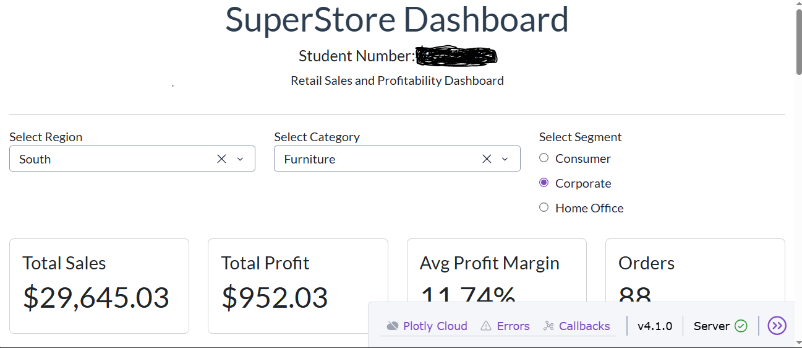
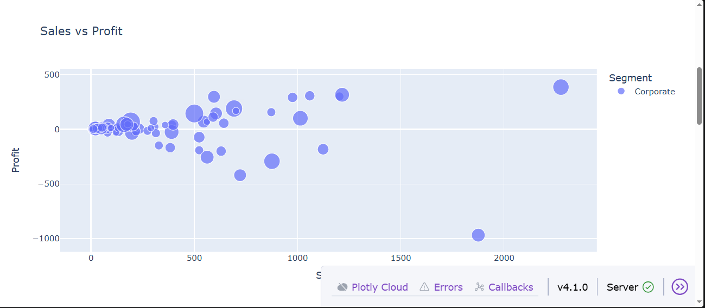
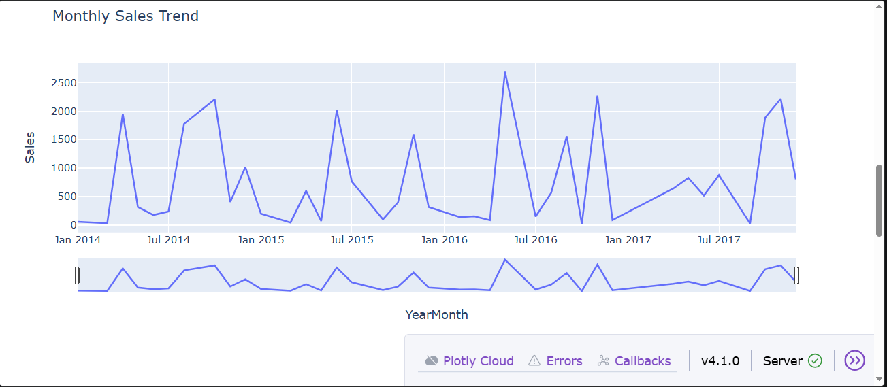

# Superstore Sales & Profitability Dashboard

An end-to-end **Data Manipulation and Visualisation** project using the Sample Superstore retail dataset. The project explores sales, profit, discounts, product sub-categories, customer segments and regional performance, then presents the results in an interactive Python dashboard built with Dash and Plotly.

> **Portfolio project:** BSc Information Technology · Data Manipulation and Visualisation 600

## Dashboard preview



### More dashboard views

| Sales vs Profit | Monthly Sales Trend |
|---|---|
|  |  |

| Regional Performance | Analysis visualisations |
|---|---|
|  |  |

## Project objectives

The assignment followed a practical data-analysis workflow:

1. Understand the business problem and load the retail dataset.
2. Explore the dataset's structure, columns and descriptive statistics.
3. Check data quality, including missing values, duplicate records, data types and outliers.
4. Perform exploratory data analysis (EDA) and investigate profitability.
5. Build an interactive dashboard that allows users to filter and compare business performance.
6. Communicate findings, limitations and recommendations.

## Business questions

The analysis was guided by three questions:

- Which product sub-categories generate the largest losses, and how do discount strategies differ between profitable and unprofitable sub-categories?
- How does profitability vary across the East, West, Central and South regions, and what factors might explain the differences?
- How are discounts and profit margins related across Consumer, Corporate and Home Office segments?

## Dataset

The project uses the **Sample Superstore** dataset, containing 9,994 order-line records and 21 columns. Fields include order and shipping dates, customer segment, region, category, sub-category, sales, quantity, discount and profit.

The dataset is included in `data/Sample - Superstore.csv` for reproducibility. The original dataset source is listed in the assignment bibliography as the [Sample Superstore dataset on Kaggle](https://www.kaggle.com/datasets/vivek468/superstore-dataset-final).

## Technologies and libraries

- **Python** — main programming language.
- **Pandas** — loading, cleaning, transforming, grouping and aggregating tabular data.
- **NumPy** — numerical and statistical calculations.
- **Matplotlib and Seaborn** — static charts, distributions, box plots and heatmaps.
- **Plotly** — interactive scatter, line and bar charts.
- **Dash** — interactive web dashboard and callback-based updates.
- **Dash Bootstrap Components** — dashboard layout and KPI cards.


## Run the dashboard locally


### Create and activate a virtual environment

**Windows (PowerShell):**

```powershell
python -m venv .venv
.venv\Scripts\Activate.ps1
```

**macOS / Linux:**

```bash
python3 -m venv .venv
source .venv/bin/activate
```

### Install dependencies

```bash
python -m pip install --upgrade pip
pip install -r requirements.txt
```

### Start the dashboard

```bash
python app.py
```

Open the local address printed in your terminal (normally `http://127.0.0.1:8050`) in your browser. Stop the server with `Ctrl + C`.

## Dashboard features

- **Region filter:** select one or more geographic regions.
- **Category filter:** focus on Furniture, Office Supplies or Technology.
- **Segment filter:** compare Consumer, Corporate or Home Office customers.
- **KPI cards:** view total sales, total profit, average transaction-level profit margin and distinct order count for the selected filters.
- **Sales vs Profit scatter plot:** inspect transaction-level relationships and identify loss-making orders. Bubble size represents quantity; hover details provide product and order context.
- **Monthly Sales Trend:** explore changes over time and use the Plotly range slider to focus on a period.
- **Regional Performance:** compare sales and profit across regions.
- **Static analysis charts:** inspect profit distribution, average profit by sub-category and correlations between numeric fields.

## Data preparation and analysis

The analysis carried out in the assignment included:

### Data quality checks

- Used `isnull().sum()` and missing-value percentages to check for missing data. The assignment reported no missing values.
- Used `duplicated()` to check for fully duplicated rows. The assignment reported zero true duplicate rows.
- Converted `Order Date` and `Ship Date` into datetime values.
- Derived shipping duration, profit margin, order year, order month and year-month fields.
- Used the interquartile range (IQR) rule and box plots to investigate outliers.
- Kept business-relevant outliers because unusually large orders, losses and discounts may represent genuine business activity rather than data errors.

### Exploratory data analysis

- Calculated mean, median, standard deviation, percentiles, minimum, maximum and range for sales and profit.
- Grouped data by category, region, segment and sub-category.
- Investigated monthly sales trends.
- Used a correlation matrix to examine relationships among Sales, Quantity, Discount and Profit.
- Isolated loss-making transactions and aggregated losses by sub-category.

## Key findings

The following figures are based on the included Sample Superstore CSV and the assignment's analysis:

- The dataset contains **9,994 records**.
- Mean sales per record are approximately **$229.86**, compared with a median of **$54.49**. The mean being higher than the median indicates a right-skewed sales distribution.
- Mean profit per record is approximately **$28.66**, compared with a median of **$8.67**, also indicating a right-skewed distribution.
- The correlation between **Discount and Profit is approximately -0.22**, a weak-to-moderate negative linear relationship. This indicates that higher discounts tend to be associated with lower profit in this dataset; correlation alone does not prove that discounts cause losses.
- When summing only negative-profit transactions, **Binders have the largest accumulated losses (approximately -$38,510.50)**.
- The dashboard makes it possible to inspect how results change when region, category and segment filters are adjusted.

### Data-validation note

The written assignment reported 1,565 loss-making transactions (15.66%). A fresh calculation on the CSV included in this repository identifies **1,871 records with negative profit** (approximately 18.72%). This difference is documented rather than silently choosing one figure. It is a useful reminder to rerun calculations against the exact dataset version used in a project before publishing final statistics.

## Recommendations explored in the assignment

1. **Review discounting on loss-making products.** Evaluate discount limits for products and transactions that frequently produce negative profit.
2. **Investigate regional performance.** Compare pricing, shipping and operating factors in regions with weaker profitability.
3. **Prioritise stronger-performing categories.** Use profit and margin analysis, not sales volume alone, when making marketing and inventory decisions.

These are analysis-based recommendations, not guaranteed forecasts of future improvements.

## What I learned

This assignment strengthened my ability to work through a complete data-analysis project, from loading raw data to communicating findings in an interactive dashboard. The main learning outcomes are documented in [Learning Outcomes](docs/LEARNING_OUTCOMES.md).

I also learned that a dashboard is not only about making charts look attractive. It should help users answer specific business questions, explore the data and make more informed decisions.

## Challenges and reflection

One of the main technical challenges was a `FileNotFoundError` because the CSV file was not in the location expected by the application. I fixed this by checking the project structure, placing the dataset in the correct location and installing the missing Python packages. This taught me to pay attention to file paths, dependencies and reproducible project setup.

I also learned to choose visualisations based on the question being answered. For example, a grouped bar chart makes it easier to compare sales and profit across regions than a pie chart when the objective is to compare two measures.

Read the full [Project Reflection](docs/PROJECT_REFLECTION.md).

## Limitations and future improvements

- The dataset does not provide every operational cost, so the analysis cannot fully explain all reasons for regional or product-level performance.
- The dashboard analyses historical data; it does not currently forecast future sales or profit.
- Customer-level purchasing behaviour and repeat-customer analysis could be expanded.
- A future version could add predictive sales forecasting, customer retention analysis, downloadable filtered data and automated tests.

## Academic context and acknowledgement

This repository presents the practical work and learning from the Data Manipulation and Visualisation 600 assignment. The dataset is acknowledged in the assignment bibliography. The dashboard implementation uses the libraries listed above.

## Author

**BSc Information Technology student**  
GitHub: [YOUR-GITHUB-USERNAME](https://github.com/YOUR-GITHUB-USERNAME)

If you found this project useful, feel free to star the repository or connect with me on GitHub.
