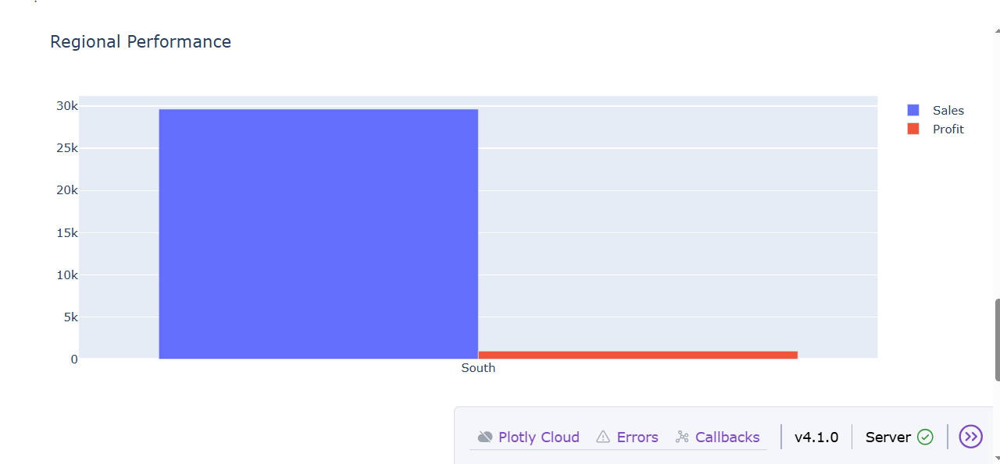
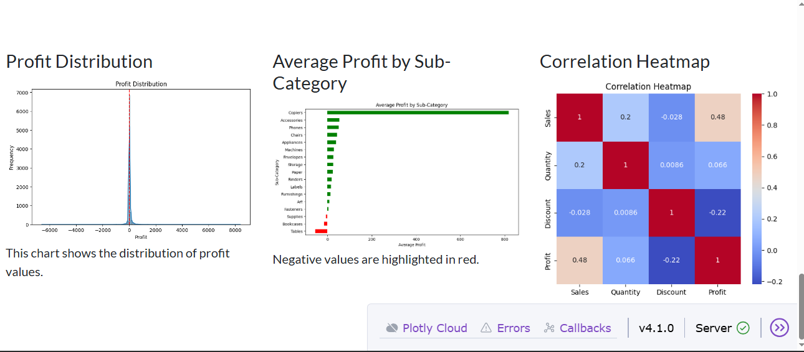

# Superstore Sales & Profitability Dashboard

An interactive retail analytics project built with **Python, Pandas, Plotly and Dash**. It explores the Sample Superstore dataset to understand sales, profit, discounts, product sub-categories, customer segments and regional performance.


## Dashboard preview

The dashboard includes interactive filters for region, category and customer segment, KPI cards, and interactive charts.

### Sales vs Profit


### Monthly Sales Trend


### Regional Performance


### Additional Analysis


## Project objectives

The assignment followed a practical data-analysis workflow:

1. Understand the business problem and load the retail dataset.
2. Explore the dataset's structure, columns and descriptive statistics.
3. Check data quality, including missing values, duplicate records, data types and outliers.
4. Perform exploratory data analysis (EDA) and investigate profitability.
5. Build an interactive dashboard to filter and compare business performance.
6. Communicate findings, limitations and recommendations.

## Business questions

- Which product sub-categories generate the largest losses, and how do discount strategies differ between profitable and unprofitable sub-categories?
- How does profitability vary across the East, West, Central and South regions?
- How are discounts and profit margins related across Consumer, Corporate and Home Office segments?

## Dataset

The project uses the **Sample Superstore** dataset, containing 9,994 order-line records and 21 columns. Fields include order and shipping dates, customer segment, region, category, sub-category, sales, quantity, discount and profit.

The CSV is stored in `data/Sample - Superstore.csv` so the analysis can be reproduced. Dataset source: [Sample Superstore dataset on Kaggle](https://www.kaggle.com/datasets/vivek468/superstore-dataset-final).

## Technologies

| Technology | Purpose |
|---|---|
| Python | Main programming language |
| Pandas | Loading, cleaning, transforming and aggregating data |
| NumPy | Numerical calculations |
| Matplotlib and Seaborn | Static charts, distributions and heatmaps |
| Plotly | Interactive scatter, line and bar charts |
| Dash | Interactive web dashboard and callbacks |
| Dash Bootstrap Components | Responsive layout and KPI cards |

## Repository structure

```text
.
├── app.py
├── requirements.txt
├── README.md
├── .gitignore
├── data/
│   └── Sample - Superstore.csv
├── docs/
│   ├── LEARNING_OUTCOMES.md
│   └── PROJECT_REFLECTION.md
└── screenshots/
    ├── sales-vs-profit.png
    ├── monthly-sales.png
    ├── regional-performance-chart.png
    └── profit-analysis.png
```

## Run the dashboard locally

### 1. Clone the repository

```bash
git clone https://github.com/denzelliljuice27-png/Superstore-Sales-profitability-dashboard.git
cd Superstore-Sales-profitability-dashboard
```

### 2. Create and activate a virtual environment

**Windows PowerShell**
```powershell
python -m venv .venv
.venv\\Scripts\\Activate.ps1
```

**macOS / Linux**
```bash
python3 -m venv .venv
source .venv/bin/activate
```

### 3. Install dependencies

```bash
python -m pip install --upgrade pip
pip install -r requirements.txt
```

### 4. Start the dashboard

```bash
python app.py
```

Open the local address shown in the terminal (normally http://127.0.0.1:8050). Stop the server with `Ctrl + C`.

## Dashboard features

- **Region filter:** select one or more geographic regions.
- **Category filter:** focus on Furniture, Office Supplies or Technology.
- **Segment filter:** compare Consumer, Corporate or Home Office customers.
- **KPI cards:** view total sales, total profit, average transaction-level profit margin and distinct order count for the selected filters.
- **Sales vs Profit:** inspect transaction-level relationships and loss-making orders. Bubble size represents quantity.
- **Monthly Sales Trend:** explore sales over time and use the Plotly range slider.
- **Regional Performance:** compare sales and profit across regions.
- **Additional analysis:** inspect profit distribution, average profit by sub-category and correlations between numeric fields.

## Data preparation and analysis

The assignment included:

- Checking missing values with `isnull().sum()` and missing-value percentages.
- Checking fully duplicated rows with `duplicated()`.
- Converting Order Date and Ship Date to datetime values.
- Deriving shipping duration, profit margin and year-month fields.
- Investigating outliers with box plots and the interquartile range (IQR).
- Calculating descriptive statistics such as mean, median, standard deviation, percentiles, minimum and maximum.
- Grouping data by category, region, segment and sub-category.
- Exploring monthly sales trends and correlations between Sales, Quantity, Discount and Profit.

Business-relevant outliers were retained rather than removed automatically, because unusually large orders and losses can be important findings.

## Key findings

- The dataset contains **9,994 records**.
- Mean sales per record are approximately **$229.86**, compared with a median of **$54.49**.
- Mean profit per record is approximately **$28.66**, compared with a median of **$8.67**.
- The correlation between **Discount and Profit is approximately -0.22**. This indicates a negative linear relationship in this dataset; correlation alone does not prove causation.
- In the assignment analysis, Binders had the largest accumulated losses among sub-categories (approximately **-$38,510.50**).

### Data-validation note

The written assignment reported 1,565 loss-making transactions (15.66%). A separate calculation on the CSV included in this repository identified 1,871 records with negative profit (approximately 18.72%). This difference is documented because results should always be checked against the exact dataset version and calculation used.

## Recommendations

1. Review discounting on products and transactions that frequently produce negative profit.
2. Investigate pricing, shipping and operating factors that may contribute to regional differences.
3. Evaluate product performance using profit and margin, not sales volume alone.

These are analysis-based recommendations, not guaranteed forecasts.

## What I learned

This project strengthened my skills in:

- Python programming and project organisation.
- Data loading, cleaning and preparation with Pandas.
- Descriptive statistics and exploratory data analysis.
- Outlier detection and correlation interpretation.
- Static and interactive data visualisation.
- Building dashboards with Dash, Plotly and callbacks.
- Debugging file paths and managing Python dependencies.
- Communicating business findings and recommendations.

More detail is available in:
- [Learning Outcomes](docs/LEARNING_OUTCOMES.md)
- [Project Reflection](docs/PROJECT_REFLECTION.md)

## Challenges and reflection

One technical challenge was a `FileNotFoundError` caused by the dashboard not finding the CSV file at the expected path. I resolved it by checking the project structure, placing the dataset in the correct folder and confirming the file name. This reinforced the importance of reproducible file paths and dependency management.

I also learned to choose charts based on the business question. For example, a grouped bar chart makes it easier to compare sales and profit across regions than a pie chart.

## Limitations and future improvements

- The dataset does not include every operational cost, so it cannot fully explain all reasons for regional or product-level performance.
- The dashboard analyses historical data and does not currently forecast future sales or profit.
- Customer-level purchasing patterns and repeat-customer analysis could be expanded.
- Future versions could add sales forecasting, downloadable filtered data, automated tests and customer retention analysis.

## Academic context and acknowledgement

This repository presents practical work and learning from the Data Manipulation and Visualisation 600 assignment. The dataset source is acknowledged above. The project uses the Python libraries listed in the Technologies section.

## Author

**BSc Information Technology student**  
GitHub: [@denzelliljuice27-png](https://github.com/denzelliljuice27-png)

If you find this project useful, feel free to star the repository.
